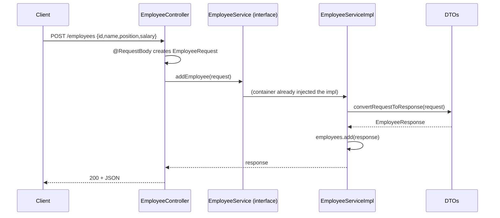

# Lesson — 26 Sept 2026: Spring Boot Layered Architecture (Controller → Service → DTO)

Files touched on 2026-09-26 (checked by `LastWriteTime`):
`EmployeeController.java` (2:48 PM), `EmployeeService.java` (2:56 PM), `EmployeeRequest.java` (2:58 PM), `EmployeeServiceImpl.java` (3:07 PM), plus the `Notes.java` cheat-sheet written at 1:50 PM.

## The explanation (one paragraph, plain words)

Think of our app like a restaurant with three rooms in a line. When a customer (the HTTP request) arrives at the door, the **Controller** is the one who opens the door and takes the order — it does no cooking, it only receives the request and hands it to the next room, then carries the answer back out. The **Service** is the kitchen where the actual work (the "business logic") happens. But here is the neat trick we learned: the Controller does *not* talk to a kitchen directly, it talks to an **interface** — `EmployeeService` — which is just a written contract that says "somewhere there must be a `getAllEmployees()` and an `addEmployee(...)`", with no body, like an empty form. The real kitchen is `EmployeeServiceImpl`, the only class that writes `implements EmployeeService` and fills in those blanks. Why bother with the contract? Because the Controller does not care *which* kitchen it gets; tomorrow we could add `EmployeeServiceDatabaseImpl` and nothing in the Controller has to change. Then there are the **DTOs** (`Data Transfer Object`s) — `EmployeeRequest` is the shape of what *comes in* (JSON from the client) and `EmployeeResponse` is the shape of what *goes out*. They are deliberately two separate classes so we never hand our internal object straight to the public API: the Service receives an `EmployeeRequest`, calls its private `convertRequestToResponse()` to build an `EmployeeResponse` (this is the mapper step — same four fields: id, name, position, salary), stores that into an `ArrayList<EmployeeResponse>` that lives as a field of the impl (that list is why the data survives after the method returns — note the field was *moved out* of the Controller this lesson; the old code kept the list in the Controller with a hard-coded constructor, and it is now commented out), and returns it. All the glue is four annotations: `@RestController` + `@RequestMapping("/employees")` say "you are a web endpoint under /employees, and return JSON", `@GetMapping` / `@PostMapping` pick the HTTP verb (`@RequestBody EmployeeRequest request` is what turns the incoming JSON body into our Java object automatically), `@Service` marks the impl so it gets built, and `@Autowired` on the Controller's field is what quietly hands the container-created `EmployeeServiceImpl` into the Controller — which is the "yung container don nilalagay lahat ng object" comment in the code. Typical runtime order: `SpringBootDitApplication.main` boots the container → container finds `@Service` and creates `EmployeeServiceImpl` → it finds `@RestController` and creates `EmployeeController` → a request to `GET /employees` (or `POST /employees`) goes Controller → Service (through the interface) → back up as JSON. Quick sanity check in the browser: `http://localhost:8080/employees` (old `UserController` answers `http://localhost:8080/user` and `/user/status`).

## Flow diagram

```mermaid
flowchart TD
    Client[Browser / Postman<br/>HTTP request] -->|GET or POST /employees| C

    subgraph Web layer
        C["EmployeeController<br/>@RestController @RequestMapping('/employees')<br/>@Autowired EmployeeService"]
    end

    subgraph Service layer
        I["EmployeeService (interface)<br/>contract only: getAllEmployees(), addEmployee()"]
        S["EmployeeServiceImpl<br/>@Service - real logic + ArrayList&lt;EmployeeResponse&gt; employees"]
        M["convertRequestToResponse()<br/>Request -> Response mapper (private)"]
        I -. implemented by .-> S
    end

    subgraph DTO layer
        RQ["EmployeeRequest<br/>JSON coming IN<br/>(needs the 4-arg constructor)"]
        RS["EmployeeResponse<br/>JSON going OUT<br/>(no-arg + setters)"]
    end

    C -->|calls the interface| I
    S --> M
    M -->|builds| RS
    C -->|@RequestBody binds JSON| RQ
    M -->|copies fields from| RQ
    S -->|add + return| RS
    RS -->|serialized to JSON| Client
```

Request-by-request trace:



## Cheat sheet (things to remember)

| Piece | Meaning | Where it shows up |
|---|---|---|
| `@RestController` | "I answer web requests with JSON" | `EmployeeController` |
| `@RequestMapping("/employees")` | base URL for this class | `EmployeeController` |
| `@GetMapping` / `@PostMapping` | which HTTP verb → which method | `getAllEmployees` / `addEmployee` |
| `@RequestBody` | JSON body → Java object, automatically | `addEmployee` |
| interface | a contract; no implementation, ever | `EmployeeService` |
| `@Service` | "create me, and I'm the implementation" | `EmployeeServiceImpl` |
| `@Autowired` | container injects the dependency for you | Controller's field |
| DTO | shape of data crossing the boundary (in vs out) | `EmployeeRequest` / `EmployeeResponse` |
| field vs local | `private List<...> employees` is a field, so data persists between requests | `EmployeeServiceImpl` |
| `convertRequestToResponse` | mapping step; `@Override` proves the impl really honors the contract | `EmployeeServiceImpl` |

## Still missing / next step (not built on 26 Sept)

Data lives in an in-memory `ArrayList`, so restarting the app wipes it. The `Repository` layer (the "DAO to the database" from `Notes.java`) is the natural next lesson — the Service already only talks to the interface, so a `EmployeeRepository` + real database can be dropped in without touching the Controller.
